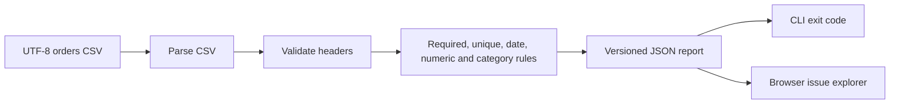

# Architecture and design decisions

## Problem

Orders exports can look plausible while containing duplicate IDs, invalid dates and missing values. These errors can distort a downstream dashboard. ClearData inspects a fixed schema and returns actionable metadata before analytics begins.

## Components

| Component | Responsibility | Boundary |
|---|---|---|
| `quality.py` | Parse, validate, report, CLI | Local UTF-8 file, no network |
| `docs/engine.js` | Parse and validate in browser | Pure functions, no DOM |
| `docs/app.js` | File/paste input, filtering, export | DOM only, no remote requests |
| `docs/index.html`, `style.css` | Accessible labels and responsive layout | Static hosting |
| `tests/` | Regression, CLI and cross-language checks | Synthetic fixtures |

## Data flow

1. Reject input larger than 2 MB and strip an optional UTF-8 BOM.
2. Parse quoted CSV, escaped quotes and multiline fields.
3. Ignore empty records; trim headers and field values.
4. Reject missing or duplicate headers and header-only input. Extra columns are permitted.
5. Record row-width problems and build counts of non-empty order IDs.
6. Apply field rules. All duplicate occurrences receive an error.
7. Count invalid records independently from issues; several errors may affect one record.
8. Return deterministic report fields. There is no timestamp or random identifier, making parity tests stable.

## Decisions

**Two engines:** the Python CLI serves analytics pipelines while the static JavaScript demo is easy to host. This duplicates rule logic, so a parity test is required for changes. A shared schema DSL is a possible future improvement.

**Bounded numeric values:** quantities are positive integers up to 1,000,000. Prices allow at most two decimal places and values from zero to one billion. Python uses Decimal. JavaScript checks format, decimal count and numeric bounds; it never computes money totals.

**No database:** the current tool needs no persisted user data. There is no login, server API or telemetry. A future history service would be a separate architecture requiring access control and retention decisions.

**Warnings vs errors:** pending payment is a business review warning, not malformed data. A pending row may be valid while still needing review before revenue recognition.

## Complexity and limits

The validator processes records and ID counts in O(n) time for a fixed column count. Parsing and reports use O(n) memory. Browser results render at most 500 issues, but JSON includes every issue. The 2 MB input bound prevents unbounded input; processing still runs on the main thread, so large allowed files can briefly affect responsiveness.

## Security and privacy

- Browser inputs remain in memory and are not uploaded or stored in localStorage.
- Imported values are displayed through `textContent`, never interpolated HTML.
- JSON export is a user-triggered local download. It contains record indices, column names and messages, not raw field values.
- A downloaded file remains on the user's device until they remove it.
- All checked-in data is synthetic. Personal application documents must never be added to this repository.
- The development HTTP server is for local previews only, not public hosting.

## Known limitations

Fixed orders schema; no custom rule editor, automatic correction, dataset history, database connectors or general OpenAPI support. A passing result means these configured checks passed, not that the underlying business facts are true. Some CSV dialects may be interpreted differently by Python's CSV reader and the browser parser; the regression suite covers supported common cases rather than claiming universal parser equivalence.
